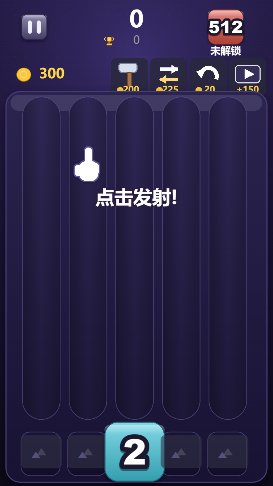
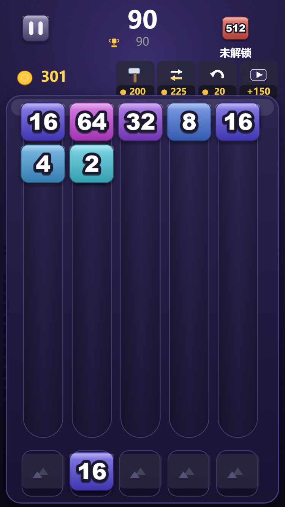
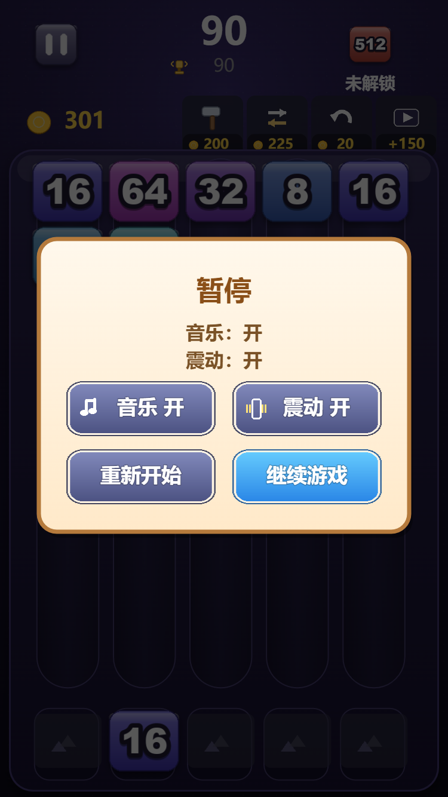
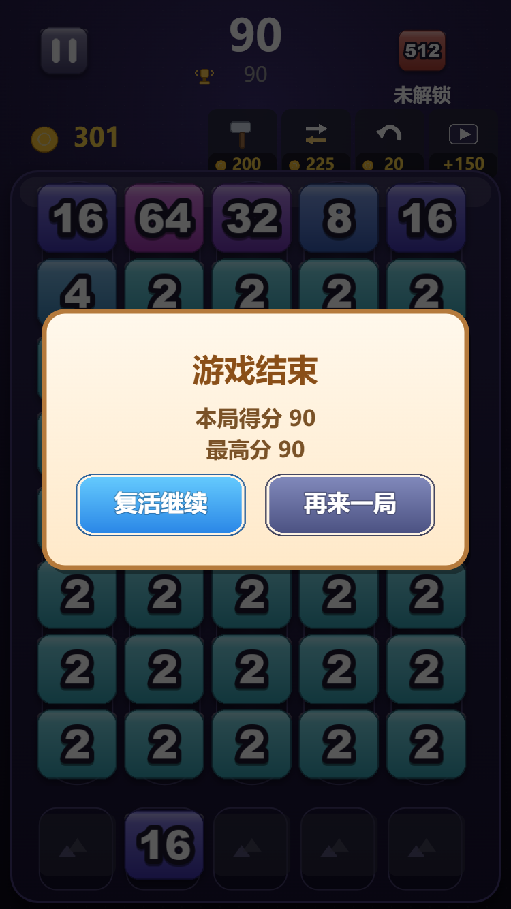

# 2048 Shooter: Number Match —— 纯 JS 复刻版

YouTube Playables 游戏 **2048 Shooter: Number Match** 的完整可玩复刻。
**零依赖**：纯 JavaScript + Canvas2D，不需要构建步骤，不需要 npm install。

> 玩法与数值 1:1 对齐原版，完整拆解见 **[docs/机制拆解.md](docs/机制拆解.md)**。

| 新手引导 | 正常对局 |
|---|---|
|  |  |

| 暂停 | 结算 |
|---|---|
|  |  |

---

## 运行

```bash
node serve.js            # 默认 http://127.0.0.1:8123/
node serve.js 8080       # 指定端口
```

然后浏览器打开 <http://127.0.0.1:8123/>。

> 必须用 HTTP 打开：图集（`.atlas` / `.png`）和音效需要用 `fetch` / `` 加载，
> 直接双击 `index.html`（`file://`）会被浏览器拦截。
> 用任意静态服务器也可以，例如 `python -m http.server`。

---

## 玩法

| 操作 | 说明 |
|---|---|
| 按下 / 拖动 | 左右移动选择列，棋盘上会显示落点光柱 |
| 拖动时上移 | 把发射器里的方块往上带（缩短飞行时间，纯手感） |
| 松手 | 把方块射入该列 |
| 暂停按钮 | 音乐 / 震动开关、重新开始 |
| 底部三个道具 | 回退（20 金币）、锤子（200）、交换（225） |
| 右侧广告按钮 | 领金币（+150 起，每日递增，上限 200） |

**目标**：把方块合成到 **2048**（内部值 11），再往上冲击 4K / 8K / …

**死亡**：5 列全部堆到**最靠近发射器的一行**（y = 7）时结束，有 2 次复活机会。

**特殊规则**：某列已经堆满时，如果**最顶上那一格的数字和你手上的方块相同**，
仍然可以射进去并立刻合并（"顶入"），这是原版刻意的救援机制。

---

## 项目结构

```
index.html              页面外壳
build.js                生成发布产物 dist/（只打包游戏运行所需文件）
serve.js                零依赖静态服务器
src/
  conf.js               常量：棋盘尺寸、布局坐标、32 组配色、经济数值、文案
  util.js               事件中心、数学工具、补间引擎、异步等待
  atlas.js              Laya .atlas 图集解析 + 九宫格绘制
  theme.js              程序化绘制背景 / 棋盘面板 / 轨道（不走图集）
  audio.js              音效播放管理
  storage.js            localStorage 存档（内存兜底）
  user.js               UserModel：金币、道具、图鉴、每日任务
  model.js              GameModel：棋盘规则引擎（发射/重力/合并/级联/死亡/RNG）
  fx.js                 特效（爆点/连击/赞美/拖尾）+ 位图字体
  view.js               GridView / BlockView：棋盘绘制与动画编排
  hud.js                Born（发射器）/ Hud（顶栏、道具栏）
  popup.js              弹窗系统（暂停 / 结算 / 复活 / 新方块解锁）
  main.js               启动、自适应缩放、主循环、输入、场景编排
assets/
  atlas/*.atlas,*.png   自制图集（3 张，由 tools/gen-assets.py 生成）
  sounds/*.wav          自制音效（12 个，由 tools/gen-sounds.py 生成）
tools/
  gen-assets.py         程序化生成全部图集（Pillow）
  gen-sounds.py         程序化合成全部音效（numpy）
  cdp.js                零依赖 Chrome DevTools Protocol 驱动（截图 / 模拟触摸）
  steps/*.json          自动化验证脚本
tests/model.test.js     无头规则测试 + 平衡性模拟
docs/机制拆解.md         原版游戏的完整逆向文档
reference/              逆向所得的原始产物（bundle.js / UI 布局 JSON / i18n）
```

---

## 素材全部自制

**运行时不含任何第三方素材。** 图集与音效都由 `tools/` 下的脚本程序化生成，
可复现、可修改，也便于商用：

```bash
python tools/gen-assets.py    # 生成 assets/atlas/*.{png,atlas}
python tools/gen-sounds.py    # 生成 assets/sounds/*.wav
node build.js                 # 产出 dist/（32 个文件，约 0.4 MB）
```

- **图集**：32 个方块（色相环铺开的 16 色 × 2 档明度）、数字贴图、按钮、图标、
  位图数字条，全部用 Pillow 现画；方块贴图的配色算法同时被 `conf.js` 复用来
  驱动瞄准光柱与爆点颜色。
- **背景/面板/轨道**：更适合直接画，放在 `src/theme.js` 用 Canvas2D 渲染，不进图集。
- **音效**：numpy 合成的 12 个音效（点击、发射、合并、连击 1~5、金币、锤子、
  交换、道具、结算），正弦/三角波 + 指数包络。

`reference/` 里保留了原游戏的逆向产物**仅供研究**，不会进入发布产物
（`build.js` 只打包 `index.html` + `src/` + `assets/`，且带校验）。

---

## 跨平台开发（Windows / Linux / macOS）

**游戏本体（`src/`）与静态服务器（`serve.js`）完全跨平台**，没有任何平台相关代码。
需要留意的是 `tools/` 下的开发辅助脚本，已做跨平台处理：

| 组件 | 跨平台情况 |
|---|---|
| `src/*`、`index.html` | ✅ 纯浏览器 JS + Canvas2D，零依赖 |
| `serve.js` | ✅ 纯 Node，使用 `path.join` |
| `build.js` | ✅ 使用 `unlinkSync`/`rmdirSync` 手写删除（`fs.rmSync` 在部分 Windows+Node 组合下会静默失效） |
| `tests/model.test.js` | ✅ 基于 Node `vm`，无浏览器依赖 |
| `tools/find-chrome.js` | ✅ 依次查 `CHROME_PATH` → 各平台常见路径 → `which`/`where` |
| `tools/cdp.js`、`record-video.js` | ✅ 通过上面的定位器找浏览器 |
| `tools/gen-*.py` | ✅ 字体按候选优先级跨平台解析（Arial Black / DejaVu / Noto CJK…） |

### 在 Debian / Ubuntu / WSL 上装依赖

```bash
bash tools/setup-linux.sh              # nodejs + npm + Pillow + numpy + Noto CJK 字体
bash tools/setup-linux-chrome.sh       # 可选：无头截图/录屏用（装 Google Chrome）
sudo apt-get install -y python3-opencv # 可选：仅生成实机视频时需要
```

装完直接自检，确认这台机器能完整跑通：

```bash
bash tools/verify-env.sh               # 构建 + 规则测试 + 素材生成 + 无头浏览器实测
```

> 本项目已在 **WSL2 Ubuntu 26.04 + Node 22 + Python 3.14 + Chrome 154** 上实测通过：
> 构建产物一致、4029 条断言全过、素材正常生成、无头浏览器驱动游戏并校验模型与渲染逐格一致。

字体解析会按这个顺序找：`ariblk.ttf` → `arialbd.ttf` → `DejaVuSans-Bold.ttf` →
`LiberationSans-Bold.ttf` → `NotoSans-Bold.ttf`；中文则是 `msyhbd.ttc` →
`NotoSansCJK-Bold.ttc` → `NotoSansSC-Bold.otf` → `wqy-zenhei.ttc`。
找不到会直接报错并列出搜索过的目录，不会静默产出错图。

### 已知的平台差异

* **OpenCV 在 Windows 上读不了含中文的路径**，所以视频编码脚本要先在纯 ASCII 目录里操作；
  在 Linux 上无此问题。
* 本机 OpenCV 缺 H.264 编码器时，`tools/encode-video.py` 会自动回退到 `mp4v`。
* **`fs.rmSync` 在部分 Windows + Node 组合下会静默失效**（报告成功但不删除），
  所以 `build.js` 用 `unlinkSync`/`rmdirSync` 手写递归删除——两个平台都正常。
* WSL 里建议把项目放在 Linux 文件系统（如 `~/game`）而不是 `/mnt/g/...`，
  否则文件 IO 明显更慢。两种位置都已验证可用。

---

## 测试

```bash
node tests/model.test.js
```

会跑 4000+ 条断言（合并规则、得分、重力、死亡判定、顶入、RNG 取值范围、复活阈值），
再用贪心 AI 模拟 30 局输出平衡性数据。

浏览器端自动化验证（需要本机有 Chrome，且服务器已在 8123 端口运行）：

```bash
node tools/cdp.js --url=http://127.0.0.1:8123/ --steps=tools/steps/consistency.json --out=_shots
```

`tools/cdp.js` 通过 CDP 模拟真实 PointerEvent，并用 `canvas.toDataURL()` 取像素截图
（headless 下页面截图会拿到过期帧，画布取像素才可靠）。

`tools/steps/` 里的脚本覆盖了这些流程，均已验证通过：

| 脚本 | 验证内容 |
|---|---|
| `consistency.json` | 连打 15 发后，**模型棋盘与渲染视图逐格一致** |
| `guide.json` | 新手引导 1→5 步可完整走完并解锁操作 |
| `tools.json` | 回退 / 锤子 / 交换三个道具，以及复活流程 |
| `back-gold.json` | 回退扣 20 金币、方块归位、棋盘与视图仍一致 |
| `swap.json` | 交换确实对调两格，且恰好扣 225 金币 |
| `restart.json` | 结算 → 重新开始 → 选择起始方块 → 新局正常开始 |

> 注意两个**符合原版设计**的现象：合并过的落子不会留下可回退的方块（`preX/preY` 会被清空），
> 所以回退道具在刚合成完时点了没反应是正常的；金币不足时道具会直接取消并提示。

---

## 实现要点

* **方块内部值是 2 的指数**：显示数字 = `2^内部值`，2^12 起用 K/M 记法，
  2^32 封顶显示为 ∞（皇冠图标）。所以 **2048 对应内部值 11**。
* **天花板即地面**：逻辑 `y = 0` 画在屏幕顶部，方块被射上去后贴顶堆叠、自上而下生长，
  发射器在棋盘下方。
* **合并规则**：N 个等值四邻方块合一 → 数值 `+(N−1)`，得分 `数值 × N`；
  对角不算相邻，所以 2×2 的同值方阵只会吃掉 3 个。
* **`next` 方块是自适应权重随机**，会随棋盘高度插入"保底"分支，优先给出能凑成合成的数字。
  完整算法见 [docs/机制拆解.md](docs/机制拆解.md) §7。

---

## 发布到 TapTap

本项目已通过 TapTap 的 **H5 小游戏**通道发布
（应用「数字射击 2048」，ID `959984`；发布时原名 2048 Shooter: Number Match，后已改名）。

```bash
node build.js     # 产出 dist/：32 个文件 / 417 KB，只含运行所需内容
```

完整流程、工具参数与踩到的坑见 **[docs/TapTap-发布说明.md](docs/TapTap-发布说明.md)**，
物料清单与发布记录见 **[docs/TapTap-商店素材清单.md](docs/TapTap-商店素材清单.md)**。

### 资料与素材维护用 `@taptap/cli`

```bash
npm i -g @taptap/cli --registry=https://registry.npmjs.org/
taptap-cli auth login                      # 浏览器授权

# 上传图片（必须先 cd 到项目根目录：路径不得越出工作目录）
taptap-cli upload ./store/icon.png --app-id 959984 --dev-id 478892 --yes
taptap-cli asset-library +upload-video ./store/trailer.mp4 \
    --app-id 959984 --dev-id 478892 --yes

taptap-cli app analyze-app-status  --dev-id 478892 --app-id 959984   # 查缺口
taptap-cli app save-changes        --dev-id 478892 --app-id 959984 \
    --data @_cli/changes.json --idempotency-key <key> --yes          # 写字段
taptap-cli app precheck-app-review --dev-id 478892 --app-id 959984 \
    --data @_cli/review.json                                         # 预检（只读）
```

> ⚠️ **`@taptap/instant-games-open-mcp` 的 `upload_image` 在本机不可用**
> （native signer 模式下缺 `TAPTAP_MCP_CLIENT_SECRET`，那是 RND 环境凭证）。
> **素材上传请改用 `@taptap/cli`**，它走另一套接口，功能完整。
>
> 另注：**版本处于「审核中」时草稿是只读的**，`save-changes` 会报
> 「游戏资料已提交或已过审」。需先 `withdraw-app-review` 撤审回到 `draft` 再改。

> ⚠️ TapTap 有两条互不相同的发布路径：
> `@taptap/maker` 面向 **Lua + UrhoX 引擎**的游戏；
> 纯 JS / Canvas 游戏应走 `@taptap/tds-mcp-server` 的 **H5 通道**（只要求目录里有 `index.html`），
> **不需要移植到 Lua**。
>
> 上传是**整目录**上传，所以务必传 `dist/` 而不是项目根目录——
> 仓库里的 `reference/` 含原游戏逆向产物，不能发布出去。

---

## 版权说明

* **`assets/` 与 `src/` 完全自制**：图集由 `tools/gen-assets.py` 生成，音效由
  `tools/gen-sounds.py` 合成，代码为本项目实现。发布产物 `dist/` 只包含这些内容，
  **不含任何第三方素材**，可自由分发。
* **`reference/`** 是从原游戏产物中逆向得到的资料（`bundle.js`、UI 布局 JSON、
  i18n 文案），**仅供研究学习，不进入发布产物**，请勿再分发。
* `docs/screenshots/00-cover.jpg` 与 `05-value-mapping.png` 为原游戏的素材截图，
  仅作为逆向分析的佐证保留在文档中。
